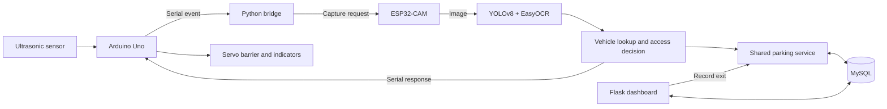

# Smart Campus ANPR

**Vehicle access and parking management with computer vision, embedded hardware and a web dashboard.**

A final-year project by **Khaw Kai Qing, Multimedia University**. The system connects an ESP32-CAM and Arduino barrier controller to a Python plate-recognition pipeline and MySQL-backed parking records. A Flask dashboard lets an administrator manage authorised vehicles, inspect access decisions and monitor parking availability.

[Run on Windows](RUN-ME.md) · [Engineering decisions](docs/ENGINEERING-NOTES.md) · [Verification record](docs/VERIFICATION.md)

> **Status:** academic prototype. The current source passes 35 automated regression cases locally. The latest changes still require live MySQL, camera and barrier integration testing. Recognition accuracy and latency have not been reproduced for this release.

## The problem

A campus entry point needs to recognise registered vehicles, reject unauthorised access and avoid admitting more vehicles than its parking capacity allows. This prototype connects those decisions to a physical barrier and gives administrators a record of activity.

The project explores the path from a sensor event to a recorded access decision, including imperfect OCR, repeated scans, database consistency and the limits of software decisions when controlling physical equipment.

## Capabilities

| Area | Implementation |
|---|---|
| Capture and recognition | ESP32-CAM image capture, YOLOv8 detection and EasyOCR recognition |
| Authorisation | Registered vehicle lookup and active-status checks |
| Parking | Category capacity, transactional reservation and release, duplicate-mutation protection |
| Hardware | Arduino Uno serial controller, ultrasonic sensor, servo, LCD and LEDs |
| Administration | Flask dashboard, vehicle registry, searchable logs, CSV export and periodic refresh |
| Web safeguards | Password hashing, form CSRF tokens, secure-cookie settings, optional API keys and audit logging |

The single-gate prototype interprets a subsequent scan of a parked vehicle as an exit. It does not independently establish travel direction; physical deployment would need additional sensing and validation.

## Architecture



The bridge talks directly to MySQL. Database commits and physical barrier movement are separate operations, so hardware failure recovery remains an integration concern.

## Run the dashboard

Use **Python 3.12** and a running MySQL service. The dashboard can be installed without computer-vision packages or connected hardware. In PowerShell, from the repository root:

```powershell
py -3.12 -m venv .venv
.\.venv\Scripts\python.exe -m pip install -r requirements-web.txt

$env:DB_HOST = "127.0.0.1"
$env:DB_PORT = "3306"
$env:DB_USER = "root"
$env:DB_PASSWORD = ""  # Set your local MySQL password if required.
$env:DB_NAME = "smart_campus_anpr_demo"
$env:SECRET_KEY = (& .\.venv\Scripts\python.exe -c "import secrets; print(secrets.token_hex(32))")
$env:ADMIN_USERNAME = "admin"
$env:ADMIN_PASSWORD = "REPLACE-WITH-YOUR-OWN-PASSWORD"

.\.venv\Scripts\python.exe Python_Code\init_db.py
.\.venv\Scripts\python.exe Python_Code\app.py
```

Choose your own administrator password of at least 12 characters before running these commands. Open **http://127.0.0.1:5000** and log in with the configured credentials. The development server binds to localhost.

Use a dedicated demo database. The initializer seeds synthetic records and updates demo capacities, vehicle attributes and the configured administrator password when rerun. For subsequent launches, set the configuration and run `app.py` without reinitializing the database.

The [Windows guide](RUN-ME.md) covers troubleshooting. [`.env.example`](.env.example) documents settings; `.env` files are **not automatically loaded**.

## Run recognition and hardware

```powershell
.\.venv\Scripts\python.exe -m pip install -r requirements.txt
$env:SERIAL_PORT = "COM5"
$env:ESP32_IP = "192.168.1.160"
.\.venv\Scripts\python.exe Python_Code\realtime_anpr_bridge.py
```

Use the actual serial port and camera IP, with the same database settings as the dashboard. Upload the Uno and ESP32-CAM sketches under `Arduino_Code/` and connect the original hardware arrangement. Configure Wi-Fi locally in the ESP32 sketch without publishing credentials.

Inference requires the trained detector at `Python_Code/best.pt`. The complete local project archive contains the recovered model and evaluation assets; they are excluded from the public repository. A fresh clone needs those assets supplied separately. EasyOCR may download recognition models on first use.

## Tests and engineering evidence

```powershell
.\.venv\Scripts\python.exe -m pip install -r requirements-dev.txt
.\.venv\Scripts\python.exe -m compileall -q Python_Code
.\.venv\Scripts\python.exe -m pytest -q
```

The current suite has **35 passing cases in the recorded local run**. GitHub Actions is configured to run compilation and tests on pushes and pull requests; check its result after publication.

| Coverage | What it checks |
|---|---|
| Plate text | Normalisation and empty input |
| Web boundaries | Login requirements, CSRF rejection, API key rejection, headers and JSON validation |
| Exports and diagnostics | CSV formula protection, audit IP handling and degraded database health |
| Parking transactions | Last-slot rejection, duplicate entry rollback, repeated exit, wrong-category rejection and rollback after a failed log write |
| Route integration | Dashboard and API exits use the shared parking service |

Parking tests execute transactions through a SQLite adapter; they do not establish MySQL concurrency behavior. Web tests use Flask's test client and controlled database substitutes. No physical hardware is needed for this suite.

See [engineering notes](docs/ENGINEERING-NOTES.md) for the duplicate-request fix and [verification notes](docs/VERIFICATION.md) for the environment and remaining checks.

## Repository layout

```text
Arduino_Code/             Uno controller and ESP32-CAM firmware
Python_Code/
  app.py                  Flask routes and dashboard
  parking_service.py      Shared transactional parking mutations
  anpr_full_system.py     Recognition and access-decision pipeline
  realtime_anpr_bridge.py Camera and serial integration
  init_db.py              Schema and demonstration data
  templates/              Dashboard pages
  static/                 Styles and images
tests/                    Automated regression checks
docs/                     Engineering, verification and portfolio notes
.github/workflows/        Continuous integration
RUN-ME.md                 Windows setup and troubleshooting
```

`Datasets/`, `OCR_Test_Images/` and `Results/` contain explanatory notes in the public source. Local evaluation files, model weights, secrets and generated crops are ignored by Git.

## Limitations and next validation

- Reproduce plate accuracy and latency on a documented held-out dataset, including difficult lighting and failed recognitions.
- Test simultaneous parking requests against MySQL with transactional tables and behavior during database disconnects.
- Test repeated camera events, direction detection, serial failures and barrier recovery using physical equipment.
- Replace the session-based login attempt counter before public deployment; clearing browser cookies bypasses it.
- Configure device API keys before exposing device endpoints. Use HTTPS and a production server beyond a local demonstration.

Plate images and access records should only be collected and shared with appropriate permission and access controls. Passing automated tests does not establish production readiness or recognition accuracy.

## Attribution

**Khaw Kai Qing — Final Year Project 2, Multimedia University.**

The project uses third-party libraries and ESP32 camera example code. Their original notices and licensing terms remain applicable. This repository does not assign a new blanket license to third-party code, model weights or datasets.
