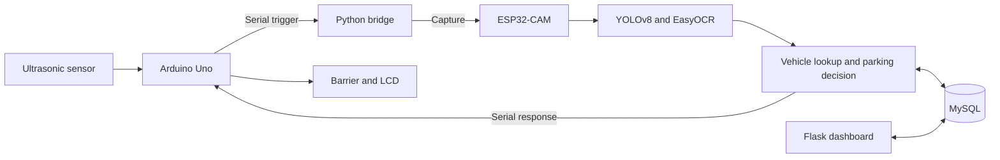

# Smart Campus ANPR

A vehicle access and parking system built with Python, Flask, MySQL, ESP32-CAM and Arduino. It reads a number plate, checks the vehicle registry, records an entry or exit, and sends a response to a barrier controller.

[](https://github.com/kaiqingkhaw/smart-campus-anpr/actions/workflows/tests.yml)

## Features

- YOLOv8 detection and EasyOCR recognition.
- Vehicle registration with Staff, Students and Visitors parking categories.
- Parking reservations and exits recorded in database transactions.
- Dashboard with parking availability, access logs and vehicle management.
- Arduino serial communication for the barrier, LCD and status LEDs.
- Administrator login, CSRF-protected forms and optional API keys for device endpoints.

## How it works



The prototype uses one gate. A scan of a vehicle already recorded as parked is treated as an exit. OCR results below the confidence threshold are rejected. Exact plate matches are checked before common OCR alternatives.

## Run locally

Requirements: Python 3.12 and MySQL. The dashboard runs without a camera or Arduino.

Start MySQL, then run these commands from the project folder in PowerShell:

```powershell
py -3.12 -m venv .venv
.\.venv\Scripts\python.exe -m pip install -r requirements-web.txt

$env:DB_HOST = "127.0.0.1"
$env:DB_PORT = "3306"
$env:DB_USER = "root"
$env:DB_PASSWORD = ""
$env:DB_NAME = "smart_campus_anpr_demo"
$env:SECRET_KEY = (& .\.venv\Scripts\python.exe -c "import secrets; print(secrets.token_hex(32))")
$env:ADMIN_USERNAME = "admin"
$env:ADMIN_PASSWORD = "REPLACE-WITH-YOUR-OWN-PASSWORD"

.\.venv\Scripts\python.exe Python_Code\init_db.py
.\.venv\Scripts\python.exe Python_Code\app.py
```

Set the database credentials for the local MySQL instance and choose an administrator password of at least 12 characters. Open [localhost:5000](http://127.0.0.1:5000) and sign in with those credentials.

Use a separate demo database. Run `init_db.py` for initial setup; rerunning it updates the seeded vehicles, capacities and administrator password. Subsequent launches only need the environment settings and `app.py`.

Configuration is listed in [`.env.example`](.env.example). The application reads environment variables; it does not load `.env` files automatically. See [RUN-ME.md](RUN-ME.md) for troubleshooting.

## Connect the hardware

1. Upload the sketches in `Arduino_Code/` to the Uno and ESP32-CAM.
2. Configure the camera's Wi-Fi settings locally.
3. Place the trained model at `Python_Code/best.pt`.
4. Set the serial port and camera address, then start the bridge:

```powershell
.\.venv\Scripts\python.exe -m pip install -r requirements.txt
$env:SERIAL_PORT = "COM5"
$env:ESP32_IP = "192.168.1.160"
.\.venv\Scripts\python.exe Python_Code\realtime_anpr_bridge.py
```

The bridge uses the same database settings as the dashboard. Model weights, training data, real plate images and runtime logs are excluded from Git. EasyOCR may download recognition models on its first run.

## Tests

```powershell
.\.venv\Scripts\python.exe -m pip install -r requirements-dev.txt
.\.venv\Scripts\python.exe -m pytest -q
```

Tests cover authentication boundaries, input validation, CSV exports, OCR acceptance rules and parking transaction behavior. Parking tests use a SQLite adapter; they do not replace MySQL concurrency or physical hardware tests. GitHub Actions runs the checks on pushes and pull requests.

## Project structure

```text
Arduino_Code/       Uno controller and ESP32-CAM firmware
Python_Code/        Flask app, recognition pipeline and serial bridge
  templates/       Dashboard pages
  static/          Styles
tests/             Regression tests
docs/              Design and verification notes
```

## Current limitations

- A repeated scan is treated as an exit; travel direction is not independently detected.
- Lighting, camera position and similar-looking characters can affect recognition. OCR alternatives can produce false matches.
- Database updates and barrier movement are separate operations. Hardware failure recovery needs live testing.
- Login attempt limits are session-based, and API keys are optional until configured. The default server is intended for local use.
- The latest changes have not been tested with the physical camera and barrier. No recognition-accuracy or latency benchmark is claimed.

[Design notes](docs/ENGINEERING-NOTES.md) · [Verification](docs/VERIFICATION.md) · [Security](SECURITY.md)

Third-party libraries and firmware retain their original licenses. Model and dataset redistribution rights must be checked separately.
